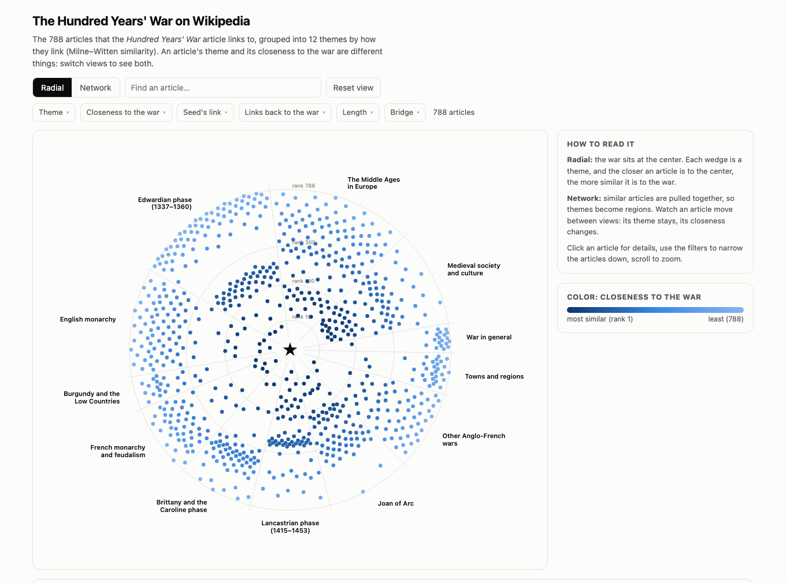

# Hundred Years' War: link-based similarity

Which Wikipedia articles are most closely related to the [Hundred Years' War](https://en.wikipedia.org/wiki/Hundred_Years%27_War), and how do they group together? This project collects the 788 articles the war's page links to, measures how similar every pair is from their links (**Milne & Witten, 2008**), clusters them into themes and publishes the result as an interactive graph.

**[▶ Open the interactive graph](https://amos-johnson.github.io/hundred-years-war-similarity/)**

[](https://amos-johnson.github.io/hundred-years-war-similarity/)

## Results

- **12 themes:**
  - the war's three phases: Edwardian, Brittany and the Caroline phase, Lancastrian
  - Joan of Arc
  - the English and French monarchies
  - Burgundy and the Low Countries
  - other Anglo-French wars
  - the Middle Ages in Europe and medieval society
  - towns and regions
  - war in general
- **The themes are stable:**
  - adjusted Rand index 0.89 across random seeds
  - 0.79 when 20% of the articles are dropped at random
  - 0.77 with a different neighborhood size
- **Theme and closeness are different axes.**
  - The Lancastrian phase and Joan of Arc sit closest to the war (median rank 230–260 of 788).
  - War in general and towns and regions sit farthest (640–690).
- **Silhouette alone misleads.** Hierarchical clustering with average linkage scores a higher silhouette than Louvain (0.28 vs 0.21), yet it puts 765 of the 788 articles in one cluster. Stability and inspection were needed to choose.
- **Navboxes leave a mark.** Templates (navboxes, sidebars) add 69% of the links between articles. One theme is 94% template-linked from the seed, while the two monarchies are 14–22%. So clusters partly follow navboxes, but most of the structure doesn't.
- **The two halves of the measure capture different things.**
  - In-links (which pages link to both articles) find the war's core: Edward III, Charles VII, Henry V, Crécy, Agincourt.
  - Out-links (which pages both articles link to) find groups listed together, such as the war's phases.
  - Spearman correlation between the two: 0.42.

## Approach

| Step | Notebook | What it does |
|---|---|---|
| 1. Collect and explore | [`01_collect_and_explore`](notebooks/01_collect_and_explore.ipynb) | The seed article and every article it links to, from the Wikipedia API: links (with redirects resolved), text and short descriptions. Each link is flagged if a template added it rather than the article's own text. |
| 2. Similarity | [`02_milne_witten`](notebooks/02_milne_witten.ipynb) | Every pair of articles compared by the pages they link to (out-links, TF-IDF-style weighted cosine) and the pages that link to them (in-links from all 7.2 million English Wikipedia articles, Normalized Google Distance). The two are combined by averaging percentile ranks, because their scales differ by about 100×. |
| 3. Clustering | [`03_clustering`](notebooks/03_clustering.ipynb) | Louvain communities on a graph joining each article to its 10 most similar articles. Evaluated by silhouette, stability (seeds, subsamples, neighborhood size) and inspection; profiled with metadata. |
| 4. Interactive graph | [`04_graph`](notebooks/04_graph.ipynb) | Radial and force-directed layouts computed in Python, exported to a static d3 page with filters, search and a table of related articles. |

**Tools:** Python, pandas, NumPy, SciPy (sparse matrices, hierarchical clustering), scikit-learn, NetworkX, matplotlib, d3.js, the MediaWiki API.

## Repository layout

```
src/
  wiki.py          Wikipedia API calls, cached as JSON
  similarity.py    Milne–Witten measures
  clustering.py    neighbor graph, Louvain, stability
  layout.py        radial and network layouts
notebooks/         the four steps above, with outputs
data/processed/    Parquet tables: articles, links, pairs, seed_similarity, clusters
docs/              the interactive page (served by GitHub Pages)
```

## Run it locally

```bash
python3 -m venv .venv
.venv/bin/pip install -r requirements.txt
```

- **Notebooks 03 and 04** run from the committed tables in `data/processed/`.
- **Notebooks 01 and 02** call the Wikipedia API on the first run. That takes about 2 hours, mostly in-links. They cache the responses in `data/raw/`, which isn't committed.
- **To open the graph locally,** double-click `docs/index.html`. Or, from the repo folder, run `python -m http.server -d docs` and go to http://localhost:8000.

## Reference

Milne, D. & Witten, I. H. (2008). *An effective, low-cost measure of semantic relatedness obtained from Wikipedia links.* AAAI Workshop on Wikipedia and Artificial Intelligence.
